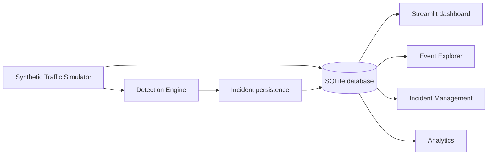

# SentinelFlow — API Security Monitoring & Threat Detection Platform

SentinelFlow is a local, educational cybersecurity MVP for reviewing API telemetry. It stores synthetic API events in SQLite, applies transparent detection heuristics, and presents the results in a dark Streamlit dashboard.

> This is a student portfolio project, not a production-grade SOC or SIEM. A triggered rule is an indicator for human investigation, never proof of malicious activity.

## Problem statement

API-heavy applications can produce large volumes of telemetry that are difficult to review manually. SentinelFlow demonstrates an approachable workflow for persisting API events, detecting a small set of suspicious patterns, and tracking the resulting investigation cases without depending on external services or real traffic.

## Features

- Persistent local SQLite storage for API events and security incidents
- Dark, responsive Streamlit dashboard with real-record metrics and Plotly charts
- Five entirely local, deterministic synthetic traffic scenarios
- Four independently testable heuristic detection rules
- Event Explorer filters for client, HTTP status, category, classification, and UTC date range
- Incident search, filtering, evidence inspection, investigation guidance, and persistent status updates
- Input validation, parameterized SQL, transactions, bounded query results, and safe error handling
- Pytest coverage for detection thresholds, empty input, SQLite persistence, duplicate prevention, and status changes

## Architecture



## Technology stack

| Layer | Technology |
| --- | --- |
| Language | Python 3.11+ |
| Web UI | Streamlit |
| Persistence | SQLite |
| Data processing | Pandas |
| Visualization | Plotly |
| Tests | Pytest |

## Installation on Windows 11

Open PowerShell in this project directory.

```powershell
cd sentinelflow
py -m venv .venv
.\.venv\Scripts\Activate.ps1
python -m pip install -r requirements.txt
```

If PowerShell blocks local activation, use the virtual environment interpreter directly in the commands below.

## Run the application

```powershell
cd sentinelflow
.\.venv\Scripts\python.exe -m streamlit run app.py
```

Streamlit prints a local URL, normally `http://localhost:8501`. On first start, the app automatically creates `sentinelflow.db` beside the source files. The database is intentionally ignored by Git, so it persists locally without being committed.

## Run tests

```powershell
cd sentinelflow
.\.venv\Scripts\python.exe -m pytest -q
```

Tests use temporary SQLite database files; they never touch your local dashboard database.

## Example workflow

1. Start the dashboard and choose **Traffic Simulator**.
2. Generate **Normal traffic** to add healthy baseline events.
3. Generate **Failed login burst**. SentinelFlow stores six synthetic failures and creates a `FAILED_LOGIN_BURST` incident.
4. Open **Incident Management**, inspect evidence and recommended next steps, then set the incident to **Investigating** or **Resolved**.
5. Return to **Dashboard** or **Analytics**. The metrics and charts are recalculated from the records now in SQLite.

## Detection rules

| Rule | Default threshold | Detection signal |
| --- | --- | --- |
| `FAILED_LOGIN_BURST` | 5 authentication 401/403 responses in 5 minutes | Repeated failed authentication per client |
| `EXCESSIVE_REQUEST_RATE` | 15 requests in 60 seconds | Client request-rate spike |
| `ENDPOINT_SCANNING` | 5 HTTP 404 responses in 5 minutes | Repeated unavailable-route requests per client |
| `SERVER_ERROR_BURST` | 4 HTTP 5xx responses in 5 minutes | Repeated server-side errors associated with a client |

Thresholds are held in the `DetectionConfig` dataclass in `detection_engine.py`. Each run emits at most one alert for the same client and rule within its active time bucket. SQLite dedupe keys prevent the same calculated alert from being saved twice.

## Security considerations

- The simulator creates in-memory synthetic records only; it sends no HTTP requests and collects no credentials.
- SQL uses parameters rather than interpolating user input.
- Event and incident fields are validated and length-bounded before persistence.
- Dashboard rendering uses Streamlit data components and JSON views, rather than injecting database strings as HTML.
- Timestamps are normalized to UTC for detection windows and storage.
- There are no hardcoded secrets, external accounts, or third-party API dependencies.

## Known limitations

- The four rules are intentionally simple heuristics and can have false positives or false negatives.
- The simulator does not ingest real logs, stream events, send notifications, or perform remediation.
- SQLite is appropriate for a single-user local prototype, not concurrent production ingestion.
- The dashboard is not authenticated and should be kept on a trusted local machine.

## Future improvements

- CSV/JSON log ingestion with schema validation
- Configurable thresholds in the UI and persistent rule profiles
- Alert correlation, suppression windows, and analyst notes
- Role-based authentication and audit logging
- PostgreSQL-backed multi-user deployment, background ingestion, and alert notifications

## Project layout

```text
sentinelflow/
├── app.py                 # Streamlit UI and charts
├── database.py            # SQLite schema and safe persistence operations
├── detection_engine.py    # Pure, independently testable heuristics
├── simulator.py           # Deterministic synthetic telemetry scenarios
├── requirements.txt
├── README.md
└── tests/
    ├── test_database.py
    └── test_detection_engine.py
```
